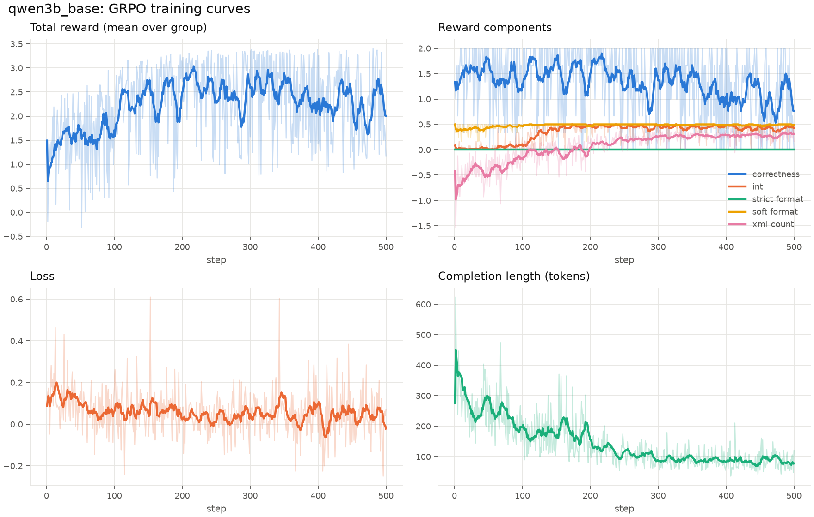

# Chasing the "Aha Moment"

**GRPO post-training experiments: reward hacking, reasoning collapse, and a revised reward setup.**

This repository started as a COMP 514 course project at Rice University by Ryan Li,
Serena You, Yuanyuan Zhu, and Diwesh Chaurasia. It now contains a Python training and
analysis pipeline for Qwen2.5-3B-Instruct on a single RTX 3060, alongside the original
Llama 3.1-8B Colab notebooks and course report.

## What we observed

In the first 500-step GRPO run on GSM8K, total reward rose while training correctness
fell and responses became much shorter. Valid XML increasingly enclosed incorrect
or nearly empty reasoning. A revised configuration recovered performance.

| Qwen2.5-3B-Instruct | GSM8K test accuracy | Mean output tokens |
|---|---:|---:|
| Instruct, no training | 62.1% | 254 |
| SFT, one epoch | 67.6% | 105 |
| GRPO base reward, step 200 | 74.5% | 138 |
| GRPO base reward, step 500 | 56.9% | 82 |
| **GRPO revised setup, step 500** | **77.3%** | 241 |

All rows use the full 1,319-problem test set. Results are single-seed comparisons;
several fixes were combined. Training length is not a measure of reasoning quality.
The original 8B report describes a different experiment and should be read separately.



The revised setup lowers format bonuses, gates them on at least 30 reasoning words,
restores KL regularization, uses Dr. GRPO normalization, and repairs the strict-format
checker. The gate discourages empty responses; it does not verify mathematical reasoning.

- **[Reward-hacking case study and real outputs](docs/reward_hacking.md)** (English).
- [Original diagnosis and fixes](docs/results_2026-10-26_grpo_vs_sft.md) (Chinese).
- [One-variable ablations](docs/results_2026-10-27_overnight_queue.md): no tested knob significantly improved the revised baseline.
- [Difficulty filtering and format-gate follow-up](docs/results_2026-10-28_data_night.md): no significant improvement over the revised baseline.
- [Four-model output comparison](docs/examples_gsm8k_four_models.md).

## Repository layout

```text
src/aha/             Python package: configs, data, rewards, training, evaluation, diagnostics
src/aha/kernels/     Optional Triton kernels; disabled by default
scripts/             Training, SFT, evaluation, plotting, and experiment runners
configs/             YAML experiment configurations and ablations
bench/               GPU microbenchmarks
tests/              CPU tests and optional GPU tests
docs/               Analyses, real examples, experiment plans, and kernel notes
notebooks/colab/    Original .ipynb files, archived unchanged
report/             Original course report and current experiment figures
```

## CPU setup and tests

Python 3.10+ is required. Parsing, reward calculations, configuration, diagnostics,
and plots can be tested without downloading a model or installing the GPU stack.

```bash
python -m venv .venv
# Linux / macOS: source .venv/bin/activate
# PowerShell:   .venv/Scripts/Activate.ps1
python -m pip install -e ".[dev]"
python -m pytest -q
```

GPU-specific tests skip when their dependencies or hardware are unavailable.

## Training on Linux or WSL2

The training stack requires an NVIDIA GPU. The 3B configurations target a 12 GB
RTX 3060; the original 8B / T4 configuration needs more VRAM. See
[model and data selection](docs/model_and_data_selection.md).

```bash
bash scripts/setup_wsl.sh
source ~/.venvs/aha/bin/activate
python scripts/check_env.py

# Two-step pipeline smoke run
python scripts/train.py --config configs/smoke.yaml

# Base configuration, then the revised configuration
python scripts/train.py --config configs/qwen2.5-3b_3060.yaml
python scripts/train.py --config configs/qwen2.5-3b_3060_fixed.yaml
```

The historical first run predates the shared strict-format checker repair. Both
commands above use the current parser, so the base configuration alone does not
exactly replay that historical checker bug.

The setup script creates a virtual environment on the Linux filesystem at
`~/.venvs/aha` by default. It pins `vllm==0.10.2`, `transformers==4.56.2`, and
`trl==0.22.2`; Unsloth is installed by the script. The recorded 3060 runs used
Unsloth 2026.10.8. GPU package compatibility can vary outside that recorded stack.

### Evaluate and inspect a run

```bash
# Untouched instruct baseline
python scripts/eval.py --config configs/qwen2.5-3b_3060.yaml --no-lora \
    --set run_name=qwen3b_instruct eval.datasets=[gsm8k_test]

# Revised adapter (run training first)
python scripts/eval.py --config configs/qwen2.5-3b_3060_fixed.yaml \
    --set eval.lora_path=outputs/qwen3b_fixed/lora eval.datasets=[gsm8k_test]

python scripts/plot_curves.py outputs/qwen3b_base outputs/qwen3b_fixed --out report/img/curves
python scripts/analyze_hacking.py qwen3b_base qwen3b_fixed --out results/hacking.md
python scripts/compare_results.py qwen3b_instruct qwen3b_sft qwen3b_base qwen3b_fixed
```

Use `--set section.key=value` for YAML-parsed overrides. Training writes
`outputs/<run>/train_log.jsonl`, checkpoints, and a final adapter. Evaluation writes
`results/<run>/<dataset>/metrics.json` and `predictions.jsonl`. Those generated
outputs, raw logs, caches, and model weights are excluded from Git. Curated analyses,
examples, and report figures are included. To rerun a diagnostic that reads raw logs,
first generate the corresponding training/evaluation outputs locally.

### Optional GPU kernel experiments

The integrated kernel work includes NF4 decode GEMM, fp16-accumulate GEMM benchmarks,
and profiling. The custom NF4 path is **off by default** and requires a compatible
CUDA / Triton environment. Enable it with `AHA_TRITON_NF4=1` for the training/evaluation
scripts. Read the [kernel overview](docs/kernels/README.md) and
[measured results](docs/results_2026-10-27_kernels.md) before using it.

## Original notebooks and report

All four original notebooks are preserved in [`notebooks/colab/`](notebooks/colab/).
They document the earlier Llama 3.1-8B / T4 experiments and are no longer the primary
entry points for local runs. The original NeurIPS-style course report remains in
[`report/`](report/).

```bash
cd report
tectonic main.tex
```

## License

[MIT](LICENSE).
