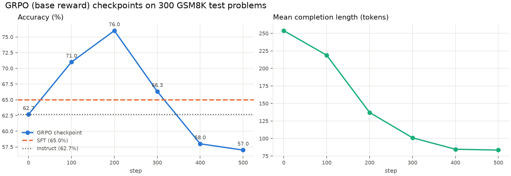

# GRPO vs SFT 对照、reward hacking 分析与 3060 性能瓶颈

日期：2026-10-26。硬件：RTX 3060 12 GB，WSL2。模型：Qwen2.5-3B-Instruct，4-bit + LoRA r=32。
所有数字由 `scripts/compare_results.py`、`scripts/analyze_hacking.py`、`scripts/profile_step.py` 生成，
曲线图在 `report/img/curves/`。

## 1. 结果总表

三个模型：未训练的 Instruct、SFT 基线（1 epoch GSM8K 金标，28 min）、GRPO base reward（500 步，64 min）。
评测温度 0.2，最长 512 token，GSM8K 用数值归一化后的 relaxed 匹配。

**GSM8K test（1,319 题）**

| 指标 | Instruct | SFT | GRPO 500 步 | GRPO 200 步 checkpoint |
|---|---|---|---|---|
| 准确率 | 0.621 | 0.676 | 0.569 | **0.745** |
| XML 可解析率 | 0.849 | 0.998 | 0.990 | 0.999 |
| 完整格式率 | 0.844 | 0.998 | 0.989 | 0.999 |
| 平均输出 token | 254 | 105 | 82 | 138 |

**AIME 2024 + 2025（60 题）**：准确率全部 0（Instruct 和 GRPO-200 各在 2024 上蒙对 1 题）。
格式率 Instruct 0.10–0.23，SFT 0.17–0.30，GRPO-200 0.37–0.40，GRPO-500 0.67–0.87。GRPO 把格式习惯带到了分布外，和论文的观察一致。

**结论**

- 500 步的 GRPO 最终比不训练还差 5 个点，是 reward hacking 的结果，不是 GRPO 不行。
- 按 checkpoint 扫一遍（下图，300 题子集），GRPO 在 200 步时达到峰值，之后一路下滑。200 步 checkpoint 在全量 test 上是 **74.5%**，比 SFT 高 7 个点，比 Instruct 高 12 个点。
- SFT 稳定但天花板低，而且在 AIME 上 43% 的输出陷入死循环（同一句话反复），说明用短答案做 SFT 损害了长推理能力。



同一道题四个模型的逐字输出对比见 `docs/examples_gsm8k_four_models.md`。

## 2. Reward hacking：有，出现在哪里


**训练曲线上的证据**（`train_log.jsonl`，按 50 步分段）

| 步 | correctness（满分 2） | int | xml count | 输出长度 |
|---|---|---|---|---|
| 0–50 | 1.58 | 0.02 | −0.48 | 282 |
| 100–150 | 1.63 | 0.31 | −0.03 | 172 |
| 200–250 | 1.52 | 0.46 | 0.15 | 123 |
| 350–400 | 1.11 | 0.45 | 0.28 | 87 |
| 450–500 | 0.93 | 0.42 | 0.28 | 90 |

总 reward 从 1.5 涨到 2.1，涨幅全部来自 int（+0.40）和 xml count（+0.76）两个格式项；
correctness 从 79% 掉到 47%。KL 全程为 0。strict format 全程为 0。

**评测输出上的证据**（`results/hacking.md`）

- 500 步模型平均 82 token，答错的 569 题里 138 题推理不到 60 token，典型样子：

  ```
  <reasoning>
  3+2=5
  5+0=5
  </reasoning>
  <answer>
  5
  </answer>
  ```
  格式分全拿，答案错。
- 3.6% 的输出 `<reasoning>` 基本为空（Instruct 和 SFT 是 0%）。
- 没有多 answer 标签、没有标签后拖尾、没有重复循环。hacking 的形态不是"乱写"，而是**把推理压缩到几乎没有**。

**发生时间**：长度从第 1 步开始单调下降，前 200 步是"去掉废话"，准确率还在涨；200 步后长度跌破约 130 token，
准确率开始跟着掉。所以 hacking 不是突然出现的，是同一个压力一直在推，越过某个长度阈值后开始伤害正确率。

## 3. 为什么会这样

按贡献大小排序：

1. **没有 KL 约束**。TRL 0.22 的 `GRPOConfig.beta` 默认 0.0，曲线里 kl 恒为 0，策略和参考模型之间没有任何约束。
   论文正文说"follow the TRL implementation, which includes KL"，但 notebook 没设 beta，实际没有。
2. **损失函数自带的长度偏置**。TRL 0.22 默认 `loss_type=dapo`，按 token 做归一化，再加组内 advantage 标准化。
   短的正确答案和长的正确答案拿同样的 reward，但梯度更新上短序列更"划算"，模型学到"少写"。
   Dr. GRPO（Liu et al. 2025）分析的就是这个偏置。
3. **格式奖励权重和正确率一样大**。int 0.5 + strict 0.5 + soft 0.5 + xmlcount 0.5 = 2.0，和 correctness 的 2.0 相等。
   格式分容易拿、方差小，是组内最稳定的 advantage 来源，模型优先把它吃满。
4. **strict format 永远拿不到**。它的正则要求 `</answer>` 后有换行再结束，vLLM 在 EOS 处停止没有尾换行，500 步全是 0。
   这 0.5 的权重白占，而 xml count 里"`</answer>` 后每个字符扣 0.001"成了唯一还能优化的方向，进一步推向短输出。
5. 采样温度 1.0、lr 5e-6、`max_grad_norm 0.1`：噪声大，约束弱，但不是主因。

## 4. 怎么解决

已实现并打包成 `configs/qwen2.5-3b_3060_fixed.yaml`，对应代码在 `src/aha/rewards.py`、`config.py`、`parsing.py`：

| 问题 | 修法 | 配置 |
|---|---|---|
| 无 KL | 恢复 KL 惩罚，DeepSeekMath 的值 | `train.kl_beta: 0.04` |
| 长度偏置 | 用 Dr. GRPO 损失，去掉按长度归一化 | `train.loss_type: dr_grpo` |
| 格式分太重 | 格式项合计 1.0，correctness 2.0 | `int/strict/soft 0.25，xmlcount 0.5` |
| 空信封 | `<reasoning>` 不足 30 词不发任何格式分 | `reward.min_reasoning_words: 30` |
| strict 失效 | 正则允许无尾换行 | 已改 `STRICT_XML_PATTERN` |
| 看不到峰值 | 每 50 步存 checkpoint，用 `scripts/sweep_checkpoints.sh` 扫 | `train.save_steps: 50` |

另外两个没放进配置、但值得在报告里讨论的方向：

- **早停**。即使不改奖励，按 checkpoint 扫一遍选 200 步也能拿到 76%。报告里的"GRPO + reward shaping"对照应该报告峰值 checkpoint 而不是最后一个。
- **长度奖励 R_len 要小心**。论文的 R_len 在答错时奖励更长的推理，这会和上面的长度塌缩方向相反，可能部分抵消 hacking，
  但也可能被反向钻空子（答错时灌水）。`qwen2.5-3b_3060_shaped.yaml` 跑完后要用同一套诊断看"答错样本是否系统性更长"。

## 5. 3060 的性能瓶颈：搬参数还是算子

`scripts/profile_step.py`，结果在 `results/profile/profile.md`。一步 GRPO 分两半。

**训练半步**（6 条 × 600 token 的前向反向，4-bit 底座 + LoRA + 梯度检查点）

| 项 | 数值 |
|---|---|
| 墙钟 | 8.4 s |
| GPU kernel 总时长 | 5.3 s → GPU 忙 63%，**37% 空转**（CPU 调度、kernel 启动、WSL） |
| GEMM（cutlass bf16 tensor core） | 3.7 s，占 kernel 时间 **70%** |
| memcpy / memset | 0.57 s，11% |
| 逐元素 / 拷贝 | 0.40 s，7.5% |
| 词表 logits 的 softmax 反向 | 0.29 s，5.5% |
| attention（flash） | 0.15 s，2.8% |
| bnb 4-bit 反量化 | 0.07 s，1.2% |
| GEMM 期间的吞吐 | 14.5 TFLOPS，约 BF16 峰值（51）的 28% |
| 整步平均 | 6.4 TFLOPS，12% |

判断：训练这一半**不是搬参数的问题**（反量化只占 1%，Unsloth 每层反量化一次后走 bf16 GEMM），是**算子**的问题，
而且算子本身效率不高：3B 模型 hidden 2048、LoRA r=32，矩阵又瘦又小，tensor core 吃不饱，GEMM 只跑到 28% 峰值；
再加 37% 的 GPU 空转。能动的手段：
- 增大 `num_generations`（6 → 8）让 GEMM 的 M 维更大，每步多出的时间很少；
- 梯度检查点已从 Unsloth 的 CPU offload 换成标准版，memcpy 从更高降到 11%；
- 词表 151k 的 logits（6×400×151936 × fp32 ≈ 1.5 GB）在 log_softmax 前后各拷一次，是 memcpy 和 softmax 的主要来源，
  TRL 新版本有分块 logprob，可以减少；
- 37% 空转大头是 WSL 下的 launch 延迟，原生 Linux 会好一截，这是换系统能拿到的最大一块。

**采样半步**（vLLM decode，6 条并发）

| 项 | 数值 |
|---|---|
| GPU kernel 时间 / decode 步 | 29.6 ms |
| 其中 bnb `gemm_4bit` kernel | **74%** |
| bf16 GEMM（lm_head、LoRA） | 11% |
| attention | 2.8% |
| 带宽下限（每步读一遍 2.35 GB 权重，360 GB/s） | 7.0 ms |
| 16-bit 加载时的实测 | 约 15 ms/步，接近其带宽下限 16 ms |

判断：4-bit 下 decode 是**算子**瓶颈，bitsandbytes 的 4-bit GEMM kernel 在 batch > 1 时很慢，每步 30 ms，
是带宽下限的 4 倍；16-bit 下才真正变成**搬参数**瓶颈（15 ms/步贴着 16 ms 下限）。所以在这张卡上 bnb 4-bit 没有换来采样速度，
只换来了显存。能动的手段：
- 采样对 batch 几乎免费（4 → 8 条只多 1 ms/步），所以多采样比少采样划算；
- 真正想提速要换 AWQ/GPTQ 这类有 Marlin kernel 的 4-bit 格式，但 Unsloth 的 QLoRA 训练要求 bnb 底座，两边不能共用权重，12 GB 放不下两份；
- 16-bit 只有 3B 以下的模型（1.5B：权重 3 GB）才能同时容纳训练，那时 decode 走带宽下限，比现在快一倍。

一句话：**训练半步卡在小而瘦的 GEMM 和 WSL 空转，采样半步卡在 bnb 4-bit 的矩阵乘 kernel；两边都不是显存带宽。**

## 6. 文件索引

| 内容 | 位置 |
|---|---|
| 三方对照表 | `results/comparison.md` |
| checkpoint 扫描 | `results/qwen3b_base_sweep.md` |
| hacking 诊断 | `results/hacking.md` |
| profiler 报告 + chrome trace | `results/profile/` |
| 曲线图 | `report/img/curves/qwen3b_base_grpo*.png`、`qwen3b_sft_sft.png`、`qwen3b_base_checkpoint_sweep.png` |
| 修正配置 | `configs/qwen2.5-3b_3060_fixed.yaml` |
