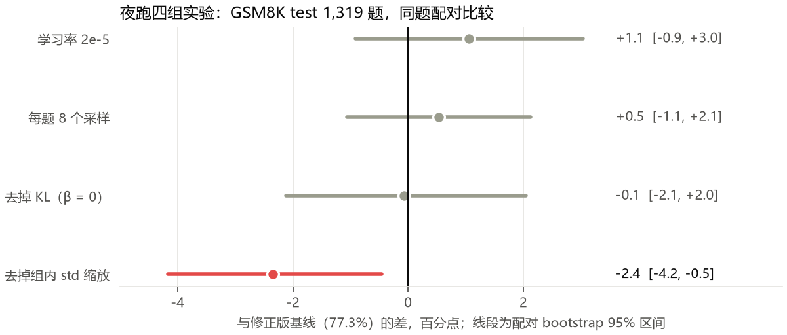

# 夜跑结果：四组单变量实验（2026-10-27）

计划见 `docs/plan_2026-10-27_next_experiments.md`。四轮都在修正版（`qwen2.5-3b_3060_fixed.yaml`，GSM8K test 77.3%）上只改一个变量，
同 seed、同题目顺序，00:05 开始，11:08 全部跑完，没有失败或 OOM。

## 结论

**没有一个改动显著超过基线。** 只有「去掉组内 std 缩放」显著变差。准确率在 77% 到 78% 这一带很稳，换学习率、换采样数、去掉 KL 都推不动它，
说明瓶颈不在这几个优化器旋钮上，按计划里的决策规则，下一步转向数据。

| 运行 | 只改了 | GSM8K test | 与基线差 | 95% 区间 | McNemar p | 只有它对 / 只有基线对 | 平均长度 | 训练用时 |
| --- | --- | --- | --- | --- | --- | --- | --- | --- |
| fixed（基线） | — | 77.3% | — | — | — | — | 241 | 110 min |
| lr2e5 | 学习率 5e-6 → 2e-5 | 78.3% | +1.1 | −0.9 到 +3.0 | 0.33 | 95 / 81 | 218 | 101 min |
| g8 | 每题 6 → 8 个采样 | 77.8% | +0.5 | −1.1 到 +2.1 | 0.59 | 65 / 58 | 236 | 119 min |
| nokl | β 0.04 → 0 | 77.2% | −0.1 | −2.1 到 +2.0 | 1.00 | 94 / 95 | 205 | 94 min |
| noscale | 组内 std 缩放 → 不缩放 | 74.9% | **−2.4** | **−4.2 到 −0.5** | **0.014** | 59 / 90 | 227 | 107 min |

比较都在同一批 1,319 题上配对做：McNemar 精确检验只看两个模型答案不一致的题，区间是对题目做 4,000 次配对 bootstrap。

**一个必须记住的限制**：这些检验只计入「评测题目抽样」的噪声，没有计入「训练本身」的噪声。每个配置只跑了一个 seed，同一配置换个 seed 重训，
准确率本身就可能差一两个点。所以 lr2e5 的 +1.1 不能当成提升，noscale 的 −2.4 也要复跑一次才能确定。

## 逐个解读

**lr2e5：方向对，但还不算数。** 训练时每 100 步的 batch 准确率都比基线高 1.5 到 8 个点，回答更短（218 token），训练快 9 分钟。
代价是离原模型更远：逐 token KL 最后 0.024，基线 0.014；回答长度分布的 KL 是 0.10，基线 0.017。没有 hacking 信号。
checkpoint 扫描是 72.7%、76.7%、74.7%（200、300、400 步），和基线的 71.7%、76.0%、77.0% 交替领先。值得当新基线的候选，但要先复跑。

**g8：没用，而且立项的理由不成立。** 计划里假设「一组 6 个全对，advantage 全是 0，白采样」，但所有运行的 `frac_reward_zero_std` 都是 0.00：
correctness 全对时，四项格式分在组内总有一点差别，总 reward 的 std 不会是 0。所以全对的组并没有被跳过，它们的 advantage 全部来自格式分的细微差别。
多采样 2 个回答，只是多了 2 份格式噪声。训练慢 8%，显存峰值约 10 GB，没 OOM。

**nokl：500 步内没塌缩，但漂得最远。** 这是消融里最有信息量的一组：

| 指标 | 基线（β = 0.04） | nokl（β = 0） |
| --- | --- | --- |
| 回答长度，前 50 步 → 后 50 步 | 282 → 256 | 274 → 219 |
| 回答长度分布 KL（相对未训练模型） | 0.017 | 0.216 |
| 格式分之和，前 50 步 → 后 50 步的涨幅 | +0.34 | +0.53 |
| 组内 reward std，最后 100 步 | 0.49 | 0.37 |
| 训练 batch 准确率，最后 100 步 | 78.5% | 84.0% |
| GSM8K test | 77.3% | 77.2% |

门控和减半的格式分自己就挡住了第一轮那种塌缩：没有 KL，回答也没缩到 90 token。但没有 KL 时，策略一直在往短、往格式漂，
组内回答越来越像（std 最低，多样性在丢），训练集准确率涨到 84% 而 test 一点没动。诊断脚本对它报了一条「格式分涨而 correctness 没涨」，
其实 correctness 也小涨了 0.06，算是边缘信号。结论：**门控是防塌缩的主力，KL 是让漂移变慢、保住多样性的保险**；
500 步看不出准确率差别，训练更久时 KL 大概率会起作用。默认配置保留 β = 0.04。

**noscale：显著变差，原因不明。** Dr. GRPO 建议不缩放，这里反而掉了 2.4 个点。日志里没有干净的解释：200 到 300 步有一次 grad norm 尖峰
（0.117，基线 0.058），那一段 batch 准确率也最低。一个想到的解释是：组内 std 通常只有 0.5 到 0.6，缩放相当于把 advantage 放大约 2 倍，
去掉它就像学习率减半；这和「lr2e5 略好、noscale 变差」的顺序一致。但 noscale 的 grad norm 并没有变小，不支持这个解释。先复跑再下结论。

## 两处更正

1. **「全对组白采样」不成立**，见上面 g8。以后要减少无效信号，该做的是筛掉对当前模型太简单的题，而不是加采样数。
2. **修正版 160 到 200 步的「低谷」主要是题目造成的。** 之前写「第一轮在同一段没有这个坑，所以不像是题目变难」，这是错的。
   六轮运行按同一顺序采题，在这一段全部下降，回答也全部变长：

   | 运行 | batch 准确率 100–150 步 | 150–210 步 | 210–300 步 | 回答长度 150–210 步 |
   | --- | --- | --- | --- | --- |
   | 第一轮（hacked） | 81.3% | 75.3% | 66.5% | 174 |
   | fixed | 73.7% | 66.4% | 74.6% | 280 |
   | lr2e5 | 82.0% | 72.5% | 76.3% | 264 |
   | noscale | 72.3% | 69.2% | 71.1% | 268 |
   | nokl | 75.7% | 74.4% | 77.8% | 237 |
   | g8 | 79.0% | 70.6% | 75.7% | 267 |

   那一段的训练题更难、需要写得更长。fixed 掉得最深（−7 个点），但每轮都掉。这也提醒：不同运行之间只能比同一段步数，不能拿某一段和另一段比。

## 下一步

1. **复跑，量训练噪声**（约 6 小时）：fixed 和 lr2e5 各换一个 seed 再跑一次。如果 lr2e5 两次都比 fixed 高，就换成新基线；noscale 也值得复跑一次。
2. **转向数据**（计划里的第二部分，按预期收益）：
   - 筛题：用当前模型对训练题各采 6 次，只留通过率在 0 和 1 之间的题，correctness 才能在组内拉开差距，而不是让格式分主导 advantage。
   - SFT 热启动再 GRPO。
   - 混入 MATH 数据，评测加 MATH-500。
3. **保留 β = 0.04 和门控**：nokl 说明门控单独就能防塌缩，KL 管的是漂移速度和多样性。

## 文件

- 汇总表和诊断：`results/queue_summary.md`
- 每轮日志：`logs/train_qwen3b_<name>.log`、`logs/eval_qwen3b_<name>.log`
- 图：`report/img/curves/queue/`（差值区间图、各轮训练曲线、长度和 correctness 叠加图）
