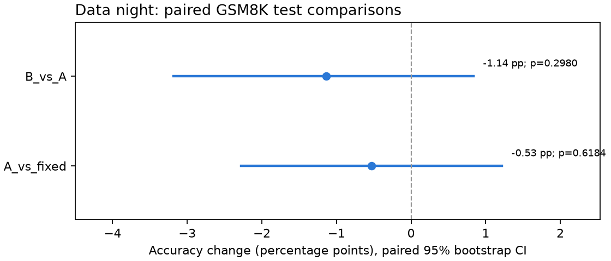
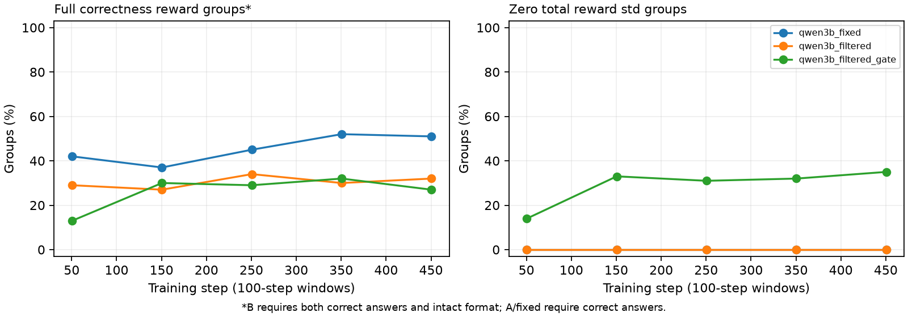

# 数据之夜结果（2026-10-28）

状态：**已完成输入核验与统计分析**。三组均有 500 个训练步、最终 LoRA，以及相同 1319 道 GSM8K test 题的逐题预测。

## 配对比较

| 比较 | 参考准确率 | 新配置准确率 | 差值（百分点） | 95% 配对区间（百分点） | McNemar p | 仅新配置对 / 仅参考对 |
|---|---|---|---|---|---|---|
| A_vs_fixed | 77.26% | 76.72% | -0.53 | [-2.27, +1.21] | 0.61845 | 69 / 76 |
| B_vs_A | 76.72% | 75.59% | -1.14 | [-3.18, +0.83] | 0.29804 | 83 / 98 |

按题号和 gold 对齐；双侧精确 McNemar，4,000 次配对 bootstrap（seed=42，百分位区间）。p 为未经多重比较校正的值；仅衡量评测题目抽样不确定性，不涵盖训练噪声。

- **A_vs_fixed**：尚无显著提升证据；保留 fixed 基线。
- **B_vs_A**：尚无显著提升证据；保留 fixed 基线。

## 预采样与训练信号

预采样 928 题，保留 461 题（49.7%，通过 1–5/6 次）。每轮 500 步，相当于 1.08 个保留题池。

| 答对次数 | 0 | 1 | 2 | 3 | 4 | 5 | 6 |
|---|---|---|---|---|---|---|---|
| 题数 | 65 | 47 | 56 | 75 | 103 | 180 | 402 |

| 运行 | 全获正确分组 | 全未获正确分组 | 混合组 | 总 reward 零 std | 平均长度 |
|---|---|---|---|---|---|
| qwen3b_fixed | 45.4% | 4.6% | 50.0% | 0.0% | 249 |
| qwen3b_filtered | 30.4% | 2.8% | 66.8% | 0.0% | 255 |
| qwen3b_filtered_gate | 26.2% | 4.2% | 69.6% | 29.0% | 273 |

A 的全对组相对 fixed 改变 -15.0 个百分点。筛题是否增加有效组，要同时检查混合组比例和分阶段回升情况。

B 的 correctness 受格式门控；这里的全获正确分组表示六个回答都正确且格式完整，全未获正确分组也可能包含答案正确但格式不合格的回答。不能直接当作原始答对组比例。总 reward 零 std 表示奖励 advantage 为零，KL 正则仍可能贡献梯度。

| 步数 | 运行 | 全获正确分组 | 全未获正确分组 | 混合组 | 零 std |
|---|---|---|---|---|---|
| 1–100 | qwen3b_fixed | 42.0% | 4.0% | 54.0% | 0.0% |
| 101–200 | qwen3b_fixed | 37.0% | 4.0% | 59.0% | 0.0% |
| 201–300 | qwen3b_fixed | 45.0% | 5.0% | 50.0% | 0.0% |
| 301–400 | qwen3b_fixed | 52.0% | 4.0% | 44.0% | 0.0% |
| 401–500 | qwen3b_fixed | 51.0% | 6.0% | 43.0% | 0.0% |
| 1–100 | qwen3b_filtered | 29.0% | 3.0% | 68.0% | 0.0% |
| 101–200 | qwen3b_filtered | 27.0% | 2.0% | 71.0% | 0.0% |
| 201–300 | qwen3b_filtered | 34.0% | 2.0% | 64.0% | 0.0% |
| 301–400 | qwen3b_filtered | 30.0% | 4.0% | 66.0% | 0.0% |
| 401–500 | qwen3b_filtered | 32.0% | 3.0% | 65.0% | 0.0% |
| 1–100 | qwen3b_filtered_gate | 13.0% | 7.0% | 80.0% | 14.0% |
| 101–200 | qwen3b_filtered_gate | 30.0% | 3.0% | 67.0% | 33.0% |
| 201–300 | qwen3b_filtered_gate | 29.0% | 3.0% | 68.0% | 31.0% |
| 301–400 | qwen3b_filtered_gate | 32.0% | 0.0% | 68.0% | 32.0% |
| 401–500 | qwen3b_filtered_gate | 27.0% | 8.0% | 65.0% | 35.0% |

## 健康检查

| 运行 | soft 格式 | 完整格式且推理 ≥30词 | 重复 | 截断 | 平均 token |
|---|---|---|---|---|---|
| qwen3b_fixed | 98.3% | 98.2% | 0.5% | 1.6% | 241 |
| qwen3b_filtered | 98.3% | 98.3% | 0.5% | 1.6% | 231 |
| qwen3b_filtered_gate | 98.0% | 98.0% | 0.2% | 1.8% | 257 |

**qwen3b_fixed**：现有诊断规则未发现红旗。

**qwen3b_filtered**：现有诊断规则未发现红旗。

**qwen3b_filtered_gate**：现有诊断规则未发现红旗。

B 相对 A 的完整格式率改变 -0.30 个百分点。门控格式率单列检查；现有 analyze_hacking 的格式奖励涨幅规则针对 graded 分项，不能独立判定 gate 健康。

## 解释与下一步

- 单 seed；统计显著也不证明跨训练随机种子可复现。两项主要比较均报告未校正 p，避免事后挑最好结果。
- A 相对 fixed 同时改变题目池、题量和重复率。缺少同规模随机子集对照，不能把差异完全归因于难度筛选。
- B 相对 A 同时把格式奖励改为常数，并给 correctness 增加格式门槛，不能单独归因于去掉格式噪声。
- 先据本次结果决定是否复跑和加入同规模随机子集对照；MATH 混入、SFT 热启动、动态筛题、pass@8 仍是候选，本次未启动。

## 复现与产物

`python scripts/analyze_data_night.py`（CPU，无需训练栈）；统计明细 `results/data_night_analysis.json`，健康诊断 `results/data_night_hacking.md`，执行状态 `results/data_night_analysis_status.json`。

